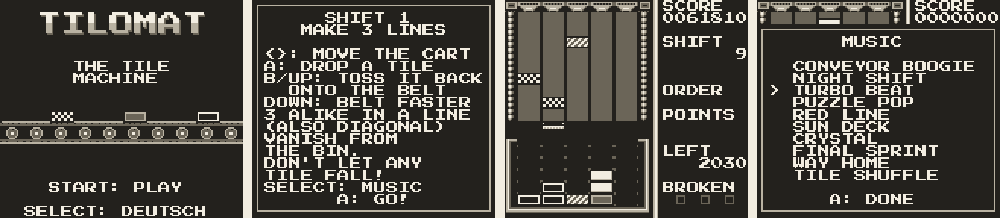

# Tilomat

The tile machine – a tile-catching puzzle game for the original Game Boy (DMG, "Game Boy Classic"),
for emulators and flash cartridges.



**Play it in the browser:** <https://dlehmann.github.io/tilomat/>

**The ROM: `tilomat.gb`** (also `build/tilomat.gb`) – 64 KB, MBC1 with 8 KB battery-backed RAM for the high
score list, the language and the song chosen.

## How to play

Tiles come out of the machine and slide down a belt of five lanes. Catch them with the cart at the near end
(it holds four) and drop them into the bin, five columns of five cells. Three or more tiles of one kind in a
line – across, up or diagonal – vanish. The tiles above fall down and may form further lines: every round of
such a cascade multiplies the points by one more.

A tile that falls off the belt breaks. The fourth broken tile ends the game; every finished shift replaces
one.

| Button        | Effect                                                         |
|---------------|----------------------------------------------------------------|
| left / right  | move the cart (repeats while held)                             |
| A             | drop the top tile into the bin; continue on the panels         |
| B or up       | toss the top tile back onto the belt                           |
| down (held)   | the belt runs four times as fast                               |
| START         | start; in the game: pause                                      |
| SELECT        | in the game: music menu; in the pause: end the game; on the title: German/English |
| name entry    | up/down: letter, left/right or A/B: position, START: save      |

### Shifts and orders

The game is played in shifts. Every shift has an order, and it ends as soon as the order is filled:

| Order            | Example                       |
|------------------|-------------------------------|
| lines            | make 3 lines                  |
| tiles            | catch 20 tiles                |
| lines of a kind  | 2 lines of the checkered tile |
| points           | score 2000 points             |
| long lines       | 1 line of 4 or more           |

The orders come in this order and grow a little with every block of five shifts. The belt gets faster with
every shift (33 frames per slot in the first, 12 at the fastest), more kinds of tile come in (3 at first, 4
from shift 3, 5 from shift 6, 6 from shift 12), and from shift 8 the joker – a star that fits every kind.

### Points

| What                         | Points                                         |
|------------------------------|------------------------------------------------|
| a caught tile                | 10                                             |
| a line of 3 / 4 / 5          | 100 / 400 / 1000, × 2 across, × 3 diagonal     |
| a cascade                    | each further round: the points × 2, × 3, …     |
| end of a shift               | 50 per empty cell in the bin + 250 × the shift |

A tidy bin pays: the bonus for empty cells is worth more than a careless line.

## Made for the Game Boy

Tilomat follows the classic way these games are played – catch, stack, drop, line up – with rules made
for the small screen and four shades of gray:

- The kinds of tile differ by pattern (white, black with a frame, dark gray, checkered, striped, diamond, the
  star of the joker), not by color, and there are at most six of them.
- A tile is 16 × 8 pixels: flat on the belt, where it moves in half rows, stacked in the bin, where it
  falls row by row. On the cart the tiles lie on top of each other like cards.
- The cart holds four tiles and catches a tile as soon as it touches the top of the stack: the fuller the
  cart, the sooner. Tossed tiles land on the nearest free slot with free slots on both sides, and
  new tiles never come out right behind another one, so tiles on the belt never touch.
- Instead of a fixed table of levels the shifts follow a formula and go on without end, for the high score.
- The break meter is not refilled every few levels: every finished shift replaces one broken tile.

Ten songs of its own come with the game, each with its own key, tempo, chords, bass line and drums: Conveyor
Boogie (the default), Night Shift, Turbo Beat, Puzzle Pop, Red Line, Sun Deck, Crystal, Final Sprint, Way Home
and Tile Shuffle. A game starts with the song chosen, and every new shift plays the next one (after the last,
the first again). SELECT in the game opens the music menu: up and down play the songs, A closes it, and the
choice is saved. The tune plays on channel 1, a second voice (a third below, an echo, an octave or an
arpeggio) on channel 2, the bass on the wave channel, kick, clap and hi-hats on the noise channel. The effects
take channel 1 from the tune while they play.

## Building

Requires: GBDK-2020 (4.4.0) in `tools/gbdk`, Python 3 with Pillow, and PyBoy for the tests and screenshots.

```
curl -L https://github.com/gbdk-2020/gbdk-2020/releases/download/4.4.0/gbdk-linux64.tar.gz | tar xz -C tools
python3 -m venv tools/venv && tools/venv/bin/pip install pillow numpy pyboy
make
```

`make` generates the files in `gen/` from `tools/gfx.py` (all tiles: font, tile kinds, belt, bin, logo,
sprites; a preview in `build/tiles.png`), `tools/text.py` (texts in German and English) and `tools/music.py`
(the songs from `tools/songs.json` into the ROM banks 2 and 3, the effects), compiles `src/` and writes
`build/tilomat.gb` and `tilomat.gb`.

`tools/songs.json` holds the ten songs, written by `tools/compose.py` (`python3 tools/compose.py`): per song
32 bars in the form A A B A, a chord progression, a bass and a drum pattern, and a tune that walks over the
chord tones in a two bar rhythm. 2 KB per song, five to a ROM bank; the one playing is copied into the RAM.

| File            | Contents                                                                    |
|-----------------|-----------------------------------------------------------------------------|
| `src/main.c`    | flow: title screen, game loop, pause, panels, name entry                    |
| `src/game.c`    | the game logic: belt, cart, bin, lines, cascades, shifts, points            |
| `src/render.c`  | the screen: machine, belt, bin, status column, panels, sprites, text        |
| `src/sound.c`   | sound chip: the songs (copied from their bank) and the effects              |
| `src/save.c`    | the high score list in the cartridge RAM                                    |

Notes on the Game Boy and SDCC:

- All tiles are loaded at `$8000`, where background and sprites share them.
- The code fills both halves of the first 32 KB, so the songs lie in the banks 2 and 3. Switching one in
  replaces `$4000-$7fff`, code included: the copy routine is `NONBANKED` and `_HOME` is linked first
  (`-Wl-b_HOME=0x200 -Wl-b_CODE=0x400`), so it lies below `$4000`, and the interrupts are off while it runs.
- Writes to the background map go into a queue that the vertical blank interrupt writes out (in assembler,
  only while the blank lasts): during the display each single write would have to wait for the next
  horizontal blank, which cost up to 150 display lines when the belt moved.
- SDCC's code for loops over arrays is slow on the Game Boy: comparing all 45 cells of the belt took 80
  display lines. The belt is now drawn by its changes, the bin by the columns that changed, and the hot
  loops use static variables and pointers.
- Divisions are avoided in the game loop (random numbers by multiplication, the score shown by adding the
  difference to its digits).
- When a frame takes too long anyway (a cascade of lines), the next frame runs an extra game tick, so the
  game keeps its speed.

## Tests

```
make test                                                              # the game logic on the PC
tools/venv/bin/python tools/autoplay.py build/tilomat.gb out 20000     # plays by itself in PyBoy
tools/venv/bin/python tools/autoplay.py build/tilomat.gb out 6000 700  # with 700 of 1000 moves wrong
tools/venv/bin/python tools/run.py build/tilomat.gb wait:150 press:start wait:60 shot:intro.png
tools/venv/bin/python tools/shots.py build/tilomat.gb                  # the images in docs/img
```

`make test` checks the lines (across, diagonal, with the joker), a cascade, the cart, and plays whole games
with a simple player. `tools/autoplay.py` reads the game state from the RAM, catches the nearest tile, drops
it where it fits best, takes screenshots and reports the speed (ticks per frame) while playing.

## The web page

`docs/` is the page on GitHub Pages: the ROM runs in `docs/gb.js`, a small Game Boy emulator in JavaScript
(from the Polonaise Game Boy project), and `docs/play.js` connects it to the page. The high score list is kept
in the browser's localStorage. `docs/fx.js` adds the motions (the title letters, sections coming into view).

## Font

The font Press Start 2P by CodeMan38 is under the SIL Open Font License (`tools/fonts/OFL.txt`).
